  

  
  
  
  

### 👋 Hola, soy Álvaro

Físico (Universidad de Salamanca) y **Senior AI Engineer** con modelos en producción para industria y energía. Mi punto fuerte es la **modelización**: entiendo el proceso físico detrás de los datos y sé cuándo hace falta un modelo físico, uno de machine learning o una combinación de ambos.

- ⚙️ **Mantenimiento predictivo** y detección de anomalías en planta
- ⚡ **Forecasting** de demanda, consumo y generación renovable
- 👁️ **Visión artificial**: inspección industrial e imagen médica
- 📚 **RAG y agentes con LLMs**, también 100 % en local

🇬🇧 Physicist & Senior AI Engineer shipping production ML for industry and energy: predictive maintenance, forecasting, computer vision and LLM/RAG systems.

---

### 🚀 Proyectos destacados

Cada proyecto incluye un **dashboard interactivo** con los resultados.

<table>
<tr>
<td width="50%" valign="top">

<b><a href="https://github.com/alvaromcib/ia-mantenimiento-predictivo">Mantenimiento predictivo</a></b> 
Vida útil restante de motores a partir de sensores. <b>84 %</b> de fallos detectados a tiempo, <b>0</b> falsas alarmas. 
LightGBM · series temporales · NASA C-MAPSS
</td>
<td width="50%" valign="top">

<b><a href="https://github.com/alvaromcib/ia-fotovoltaica-fisica-ml">Fotovoltaica: física + IA</a></b> 
Modelo híbrido de producción (error <b>2,3 %</b>) y detección de inversores que pierden ≈ <b>30 k€/año</b>. 
Modelo físico · LightGBM · detección de anomalías
</td>
</tr>
<tr>
<td width="50%" valign="top">

<b><a href="https://github.com/alvaromcib/vision-epis-obra">Visión artificial: EPIs en obra</a></b> 
Casco, chaleco y EPIs ausentes en tiempo real, en CPU (~<b>53 ms</b>/imagen), con <b>0</b> falsas alarmas «sin casco». 
YOLO11 · detección de objetos · edge
</td>
<td width="50%" valign="top">
<b><a href="https://github.com/alvaromcib/parasite-detection">Detección de parásitos en microscopía</a></b> 
Recuento automático de huevos de <i>Nematodirus</i> y <i>Strongyloides</i>: EDA, auditoría de etiquetas, recorte de campo de visión y experimentos con SAHI y DINOv2. 
YOLO11 · SAHI · imagen biomédica
  
<b><a href="https://github.com/alvaromcib/Med-RAG">Med-RAG</a></b> 
Asistente RAG para neurorradiología desplegable on-premise, con LLM local. 
LlamaIndex · Qdrant · Ollama
</td>
</tr>
</table>

---

### 🧰 Stack

**ML / DL**&nbsp;

**Visión**&nbsp;

**LLM / RAG**&nbsp;

**Datos y despliegue**&nbsp;

---

### 🏭 En producción

- **Forecasting de demanda eléctrica a gran escala** integrado con SCADA, desplegado en varias regiones con PostgreSQL particionado.
- **Gemelo digital de un horno industrial**: miles de simulaciones en supercomputación y un metamodelo para optimizar consumo.
- **Mantenimiento predictivo y control de calidad** en siderurgia y automoción.
- **Visión por computador** en la librería OpenNN y el software Neural Designer.

🎓 BSc Física (USAL) · MSc Data Science (UCM) · MSc Física Médica (UNED, en curso)

<b>¿Tienes datos de planta, sensores o documentación técnica y no sabes por dónde empezar?</b> 
<a href="https://www.malt.com/profile/alvaromartincoll">Hablemos en Malt</a> · <a href="https://www.linkedin.com/in/alvaromartincoll">LinkedIn</a>

